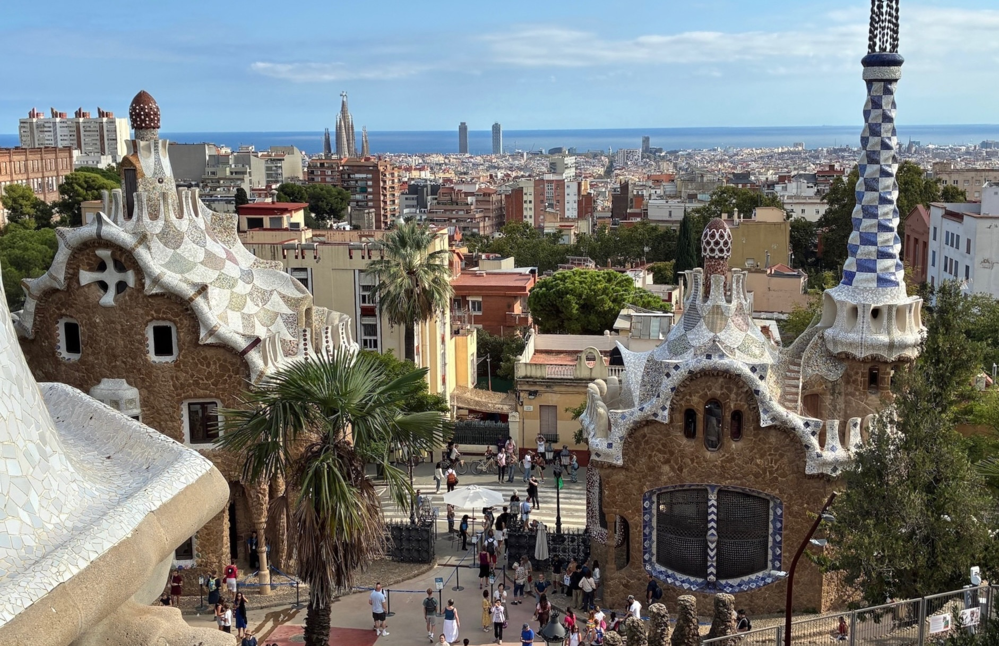

# aidai
MindARを使った画像トレッキングです 
URLに遷移し、ターゲット画像を認識すると別の画像が表示されます 
このコードはchat gptを使って数秒で作成されたコードです 
https://jirochanf.github.io/aidai/kantan.html 

ファイル構成
aidai/ 
├── kantan.html 
├── targets_barcero.mind 
└── 26eu00001.JPG 

## dejisa
デジタルサイネージテンプレート 
デジタルサイネージをWebで実現します 
このテンプレートの画像・動画を変更するだけで完了します 
https://jirochanf.github.io/aidai/dejisa/index.html
